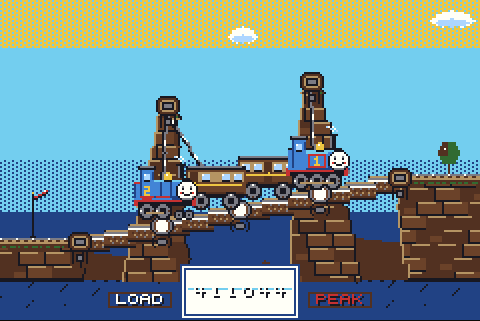
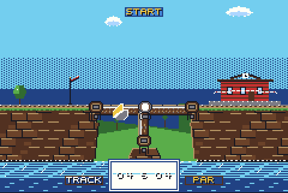
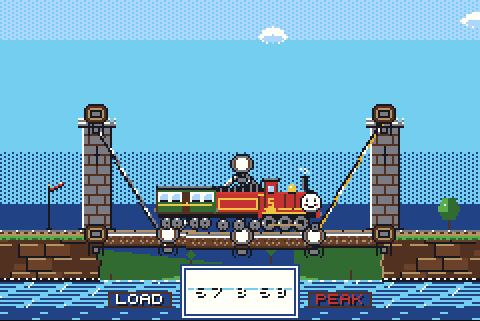
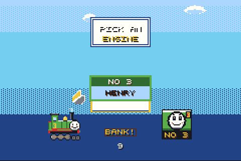
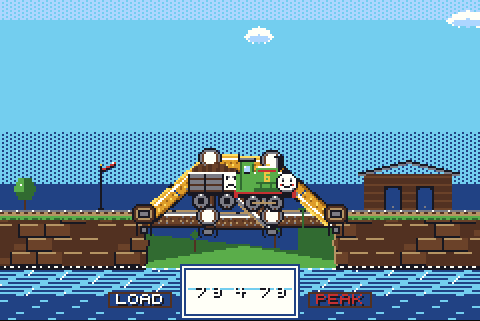
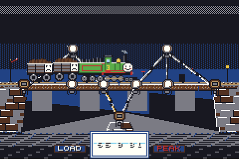
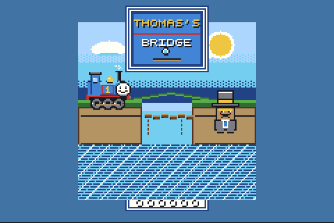
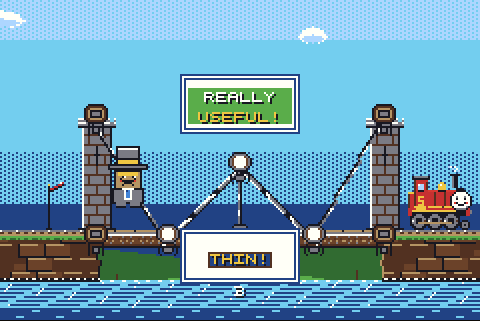

# Thomas's Bridge

A bridge-building puzzle game for the **Game Boy Advance**. Weld timber, steel rod and cable across eight gaps on the Island of Sodor, then send a train over it and find out whether you were right.

[](https://github.com/hackmods/morris-bridge-gba/actions/workflows/release.yml)
[](rom/thomas_bridge.gba)
[](docs/README.md)



The bridge is simulated as a real structure. Joints have weight, beams carry force and snap when they have had enough, and a deck with nothing under it falls into the river. The product is the ROM; the browser page is an emulator running that ROM.

> A fan-made parody for friends. Original pixel art and music. **Not affiliated with or endorsed by Mattel, Gullane, or anyone who owns Thomas & Friends.**

## Play it

| How | What to do |
|-----|-----------|
| **Emulator** | Open [`rom/thomas_bridge.gba`](rom/thomas_bridge.gba) in [mGBA](https://mgba.io/) |
| **Real hardware** | Copy the ROM to a GBA flash cart (EverDrive GBA and similar) — see [hardware](docs/hardware.md) |
| **Browser** | `./scripts/sync_rom_to_web.sh && cd web && npm install && npm run dev`, then open http://127.0.0.1:4317 |
| **Docker** | `./scripts/sync_rom_to_web.sh && docker build -t thomas-bridge . && docker run --rm -p 8080:80 thomas-bridge` |

### Controls

| GBA | Keyboard (browser) | Does |
|-----|--------------------|------|
| D-pad | Arrow keys | Move the cursor |
| **A** | Z | Select a joint, then weld to another spot. Hold and drag to chain-weld |
| **B** | X | Delete the joint or beam under the cursor |
| **R** | R | Next material: timber → rod → cable. Hold with the D-pad to move faster |
| **L** | L | Undo the newest weld; keep pressing to unwind further |
| **Start** | Enter | Send the train. Press again to call it back. Hold **A** during the run for double speed |
| **Select** | Backspace | Pause |

## How a bridge works

| | |
|---|---|
|  |  |
| **Build.** Anchors are the only solid ground. Everything else you weld has weight. | **Test.** Links turn amber at half their strength and red near breaking. |

- **Timber** carries the rails. Cheap, short, snaps at 8.
- **Rod** is a brace that pushes or pulls. Costs double, reaches further, snaps at 12.
- **Cable** is cheap and long and holds 12, but only in tension. Push on it and it goes slack.
- The bridge **settles under its own weight** before the train leaves. If it cannot hold itself up, you find out early.
- A snapped link dumps its load on its neighbours. Collapses cascade.
- Engines **slow uphill**, including on the sag of your own deck.
- **Troublesome Trucks** bump along and shake the bridge. Coaches do not.
- Every level has a **par** cost for three stars and a **purse** (1.5× par) you cannot exceed.
- After a failed run the bridge comes back as built, with the links that gave way still glowing.

The full rules are in [game design](docs/game-design.md); the maths is in [physics](docs/physics.md).

## The engines



| No. | Engine | Pulls | Total load | Unlock |
|-----|--------|-------|-----------|--------|
| 1 | Thomas | Annie and Clarabel | 6 | Start |
| 2 | Edward | Tender, one coach | 7 | Clear Gordon's Hill |
| 3 | Henry | Tender, two trucks (the Flying Kipper) | 9 | Clear Culdee Fell |
| 4 | Gordon | Tender, two express coaches | 14 | Clear every track |
| 5 | James | Tender, one coach | 8 | Clear Tidmouth |
| 6 | Percy | One truck | 4 | Clear Knapford |

Each track is timetabled for one engine. A lighter engine will get you across for one star. Gordon breaks every par design in the game except Gordon's Hill, where Edward pushes him up from behind.

## The line

| # | Track | What you get | What it asks for |
|---|-------|--------------|------------------|
| 1 | Knapford | A rock in the river | A prop |
| 2 | Gordon's Hill | Two crags over a climb, and Edward banking | Cables |
| 3 | Culdee Fell | Nothing | A truss |
| 4 | Tidmouth | Nothing, and only timber | A truss in wood |
| 5 | Wellsworth | Ledges low in the cutting | Struts from below, under bumping trucks |
| 6 | Crovan's Gate | One rock, off-centre | A trestle and a free span |
| 7 | Callan | A castle tower on each bank | Stays |
| 8 | Vicarstown | One pier in the channel | The bridge to the mainland |

| | |
|---|---|
|  |  |
|  |  |

## Under the hood

- **Engine:** [Butano](https://github.com/GValiente/butano), C++20, built with devkitARM
- **Simulation:** a fixed-point pin-jointed truss solver — no floating point, no heap, four substeps a frame at 60 fps on a 16 MHz ARM7
- **Art:** every sprite and background is generated by [`tools/gen_graphics.py`](tools/gen_graphics.py); each level's terrain is drawn from the same anchor table the game uses
- **Proof:** host tests check, for all eight levels, that an unsupported deck collapses, that the par design holds at par cost, and that removing any single link from it loses the train

### Build and test

```bash
./scripts/build_rom.sh        # ROM, in Docker (no local devkitARM needed)
make -C tests                 # host physics, session, progress and save tests
cd web && npm ci && npm test  # web unit tests
npx playwright test           # end-to-end, drives the ROM in mGBA-WASM
```

More in [building the ROM](docs/building-rom.md) and [testing](docs/testing.md).

## Documentation

[`docs/README.md`](docs/README.md) is the index. The pages most people want:

| Topic | Link |
|-------|------|
| Rules, engines, levels, result lines | [Game design](docs/game-design.md) |
| The structural model | [Physics](docs/physics.md) |
| Sprites and generated terrain | [Graphics](docs/graphics.md) |
| The backstory, for friends | [Lore leak](docs/lore-leak.md) |
| What changed and when | [Changelog](docs/changelog.md) |

## Repository

| | |
|---|---|
| **Game title** | Thomas's Bridge |
| **ROM** | `thomas_bridge.gba` (header `THOMASBRIDGE` / `THOM01`), about 420 KB, committed for clone-and-play |
| **Repo name** | `morris-bridge-gba` is the working codename and stayed |
| **Licence** | [MIT](LICENSE) for this project's code, art and music. The characters are not ours to license — see [NOTICE](NOTICE). Butano, the engine, is zlib-licensed |
