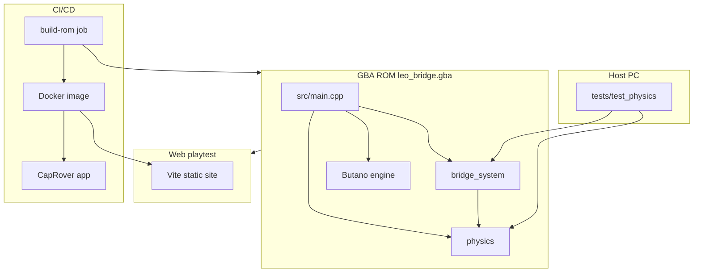

# Architecture

## High-level system



## Source modules

| Path | Responsibility |
|------|----------------|
| [`include/physics.h`](../include/physics.h) | Distance, sqrt, tension, max-tension-by-length |
| [`src/physics.cpp`](../src/physics.cpp) | Implementations shared by GBA and host tests |
| [`include/bridge_system.h`](../include/bridge_system.h) | Node/strut graph, BFS path, train simulation |
| [`src/bridge_system.cpp`](../src/bridge_system.cpp) | `BridgeSystem` state machine |
| [`src/main.cpp`](../src/main.cpp) | Input, sprites, HUD labels, game loop |
| [`graphics/`](../graphics/) | Indexed BMPs + Butano JSON metadata |
| [`tests/`](../tests/) | Host `bn::fixed` mock + integration tests |
| [`web/`](../web/) | Browser emulator UI (mGBA-WASM) |

## Game loop (GBA)

```text
bn::core::init()
loop forever:
  read keypad
  if build mode: move cursor, place/connect nodes
  if test mode:  bridge_system.update()
  sync sprite positions for nodes, struts, train, labels
  bn::core::update()
```

## Memory model

- **Nodes:** `bn::vector<Node, 16>`
- **Struts:** `bn::vector<Strut, 32>`
- **No heap:** no `new` / `delete`; optional values use `bn::optional`
- **Test snapshot:** struts copied to `_saved_struts` before simulation; `end_test()` restores them

## Coordinate system

Butano sprites use a **center-origin** screen space:

- X roughly −120 … +120
- Y roughly −80 … +80 (Y increases downward on GBA)

The canyon is seeded with anchored nodes at the left and right banks (`START_NODE`, `END_NODE`).

## Web playtest architecture

See [Web playtest](web-playtest.md). Summary:

- **mGBA-WASM** runs the same ROM in a `<canvas>`
- **Keyboard** via `bindKey`; disabled while command input is focused
- **Input queue** serializes `buttonPress` / `buttonUnpress` with configurable hold ms
- **nginx** (production) or **Vite dev server** must send COOP/COEP headers
