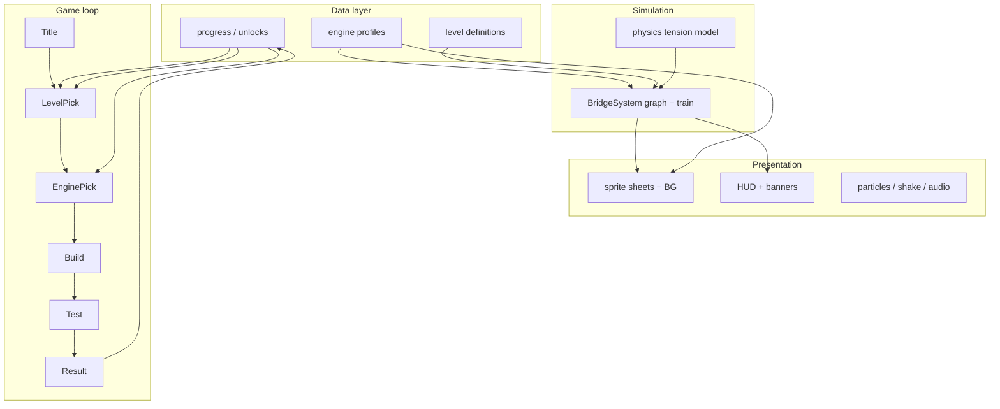

# Full game roadmap — engines, co-base systems, and graphics

Plan for turning **Thomas's Bridge** from a mechanics prototype into a flushed-out friends ROM: unlockable engines, weight-driven difficulty, progression loop, and graphics that feel **immersive** instead of procedurally “shitty placeholder” art.

Related: [Game design](game-design.md) · [Lore leak](lore-leak.md) · [Graphics pipeline](graphics.md) · [Physics](physics.md)

---

## 1. Vision

| Layer | Today | Target |
|-------|-------|--------|
| **Gameplay** | One train, one weight, 3 levels, meme HUD | Pick engine → build → test → unlock next character/track |
| **Physics** | Global `BASE_WEIGHT = 4` | Per-engine weight + optional speed/coach count |
| **Progression** | All levels open, no saves | Level gates + engine unlocks + optional SRAM |
| **Graphics** | Python blit templates, 16×16 train blob | Hand-authored GBA art, BG parallax, juice |
| **Tone** | Meme + optional PG lore | Same surface; lore whispers in rare strings |

---

## 2. Engine model (expand beyond weight)

Starter code lives in [`include/engine.h`](../include/engine.h) and [`include/progress.h`](../include/progress.h). Each **engine profile** should eventually carry:

| Field | Purpose | Gameplay effect |
|-------|---------|-----------------|
| `weight` / `speed` | Simulation load and crossing rate |
| `menu_frame(id)` | Derived from `Id` — select-screen tile index |
| `train_frame_base(id)` | Derived from `Id` — sprite sheet row |

### Launch roster (v1 target)

| Engine | Weight | Speed | Unlock | Kid reads | Friend reads |
|--------|--------|-------|--------|-----------|--------------|
| **Thomas** | 4 | 1.0 | Start | Hero | Default loop prisoner |
| **Percy** | 3 | 1.0 | Beat Knapford | Light engine | Buffer-overflow scout |
| **Edward** | 5 | 1.0 | Beat Gordon's Hill | Old and careful | Remembers off-map routes |
| **James** | 6 | 1.0 | Beat Vicarstown | Shiny red | Wrong reflection |
| **Gordon** | 10 | 1.0 | Clear all 3 tracks | Big express | Escape needs momentum |

**Design rule:** Percy is the *reward* engine (easier). Gordon is the *prestige* engine (hard mode).

### Future roster hooks

Reserve `engine::Id` slots for **Toby** (tram — narrow gauge = different snap radius?), **Diesel** (liar — stat screen lies about weight?), **Emily** (mixed traffic). Do not implement until core loop ships.

---

## 3. Co-base factors (systems that must exist together)

These modules share data and must be designed as one stack — “co-base” = common foundation before content scale.



### 3.1 Progress (`progress::Progress`)

| Responsibility | Detail |
|----------------|--------|
| Level unlock | Sequential: Knapford → Gordon's Hill → Vicarstown |
| Engine unlock | Reward on first clear per level + Gordon when all cleared |
| Session vs save | **v1:** RAM session (resets on power off). **v2:** Butano SRAM 256 B save block |
| Cleared bitmask | Track replays, star ratings, lore flags |

### 3.2 Level definitions (replace raw seed arrays)

Evolve [`bridge_system.cpp`](../src/bridge_system.cpp) `LevelSeed[]` into:

```cpp
struct LevelDef {
    const LevelSeed* seeds;
    int seed_count;
    const char* name;
    engine::Id recommended_engine;  // UI hint only
    bn::fixed wind_bonus;           // future: lateral force
    int bg_theme_id;                // palette + BG tileset
};
```

Enables **per-level art theme** (creek vs hill vs lift-bridge) without forked code paths.

### 3.3 Physics co-factors

Already in [`physics.h`](../include/physics.h). Extend carefully:

| Constant | Today | Tunable per level? |
|----------|-------|---------------------|
| `BASE_WEIGHT` | 4 | → per-engine `Profile::weight` |
| `SAFE_LENGTH` | 48 px | Could drop on Gordon's Hill |
| `BASE_MAX_TENSION` | 8 | Could rise with “upgrade” meta (future) |
| `TRAIN_SPEED` | 1 px/frame | → per-engine `Profile::speed` |

**Preview honesty:** Build-mode weak-strut warning must use **selected engine weight**, not global `BASE_WEIGHT` ([`main.cpp`](../src/main.cpp) preview path).

### 3.4 Game loop screens (target)

| Screen | New? | Notes |
|--------|------|-------|
| Title | — | Animated splash, engine silhouette parade |
| Level select | — | Lock icon on gated tracks |
| **Engine select** | **Yes** | Shows weight digit, locked gray sprite |
| Build / Test | — | HUD shows engine name + weight |
| Level complete | — | “Percy unlocked!” toast |
| All complete | — | Gordon unlock + lore sting |

### 3.5 Meta / juice co-factors

| System | Immersion payoff | GBA cost |
|--------|------------------|----------|
| Screen shake on snap | Bridge failure feels physical | Cheap (camera scroll nudge) |
| Dust puff on landing | Weighty arrival | 4–8 particle sprites |
| Strut stress creak | Visual warning before snap | Already have `STRUT_HOT` — add pulse |
| Hatt reaction frame | Stern vs furious tied to fail type | Exists — wire to fail reason |
| Rare lore HUD | Friends replay for screenshots | Done (~4% roll) |

---

## 4. Why the graphics feel “shitty” now

Honest audit of [`tools/gen_graphics.py`](../tools/gen_graphics.py):

| Asset | Problem |
|-------|---------|
| **Train** | 16×16 ASCII template scaled to 32 on splash — no wheel rotation, no cab depth, identical chuff |
| **Struts** | 16×1 flat line — reads as laser, not timber |
| **Nodes** | 8×8 dots — fine for prototype, invisible as “engineering” |
| **Sky/ground** | Repeated 64×64 tiles, 2-frame water — flat parallax |
| **Hatt** | Floating 16×16 head — no body, no scene presence |
| **UI** | Blocky panel boxes — Pokémon-adjacent but not illustrated |
| **Palette** | Single global 16-color sheet — engines cannot have distinct reds/greens without swap |
| **No BG mode** | Everything is sprites — burns OAM, limits depth |

The generator is **good for CI and placeholder consistency**, not for final art. Treat it as **layout + palette proof**, then replace BMPs.

---

## 5. Graphics upgrade strategy (immersive on GBA)

Goal: **believable Sodor canyon bridge scene** at 240×160, not AAA — think *Advance Wars* clarity + *Mario vs Donkey Kong* charm.

### Phase A — Art pipeline (do this first)

1. **Author in Aseprite** (or LibreSprite) at native sizes:
   - Engines: **32×32** side view, **4–6 frames** (idle, chuff ×2, strain, celebrate)
   - Struts: **16×8** wood beam with highlight edge (rotate in engine)
   - Nodes: **16×16** riveted joint or trestle cap
2. **Export indexed BMP** — max 16 colors per sprite, index 0 transparent.
3. **Drop into `graphics/`** — keep JSON basename (`train.json` → `bn::sprite_items_train`).
4. **`gen_graphics.py` becomes validator** — palette check, dimension check, optional compose-only for HUD text.

```bash
# Future workflow
python3 tools/validate_graphics.py   # lint palettes + sizes
make                                   # Butano rebuilds sprite items
```

### Phase B — Background layers (biggest immersion win)

Move static scenery off sprites into **regular BGs**:

| Layer | Content | Mode |
|-------|---------|------|
| BG0 back | Sky gradient + distant hills | 256-color or shared palette |
| BG1 mid | Far cliff + trees | scroll 0.25× |
| BG2 play | Near banks, water surface | scroll 0.5× with camera |
| Sprites | Train, nodes, struts, Hatt, FX | OAM |

Butano supports [`bn::bg_palettes`](https://github.com/GValiente/butano) + affine BG scroll for parallax. **Per-level BG tilesets** (`knapford_bg.bmp`, `hill_bg.bmp`, `vicarstown_bg.bmp`).

Water: **8-frame ripple** tile animation in BG, not 2-frame sprite tiles.

### Phase C — Engine identity (characters feel real)

| Technique | Detail |
|-----------|--------|
| **Separate sprite sheets** | `train_thomas.bmp`, `train_percy.bmp`, … OR one tall sheet with 5×6 frames |
| **Palette swaps** | Same silhouette, different 16-color sub-palette for James red / Gordon gray |
| **Coach sprites** | 16×16 follow cars parented to train path (Phase 2 gameplay) |
| **Select screen portrait** | 64×64 bust + weight badge |

### Phase D — Bridge “realness”

| Element | Upgrade |
|---------|---------|
| Struts | Wood grain + shadow underside; **snap animation** (crack frame before erase) |
| Nodes | Metal bracket visible at joints |
| Preview strut | Dashed ghost line + sag curve (second sprite segment) |
| Tension | Color lerp green → yellow → red on strut (palette row swap) |

### Phase E — UI polish

| Element | Upgrade |
|---------|---------|
| Panels | Illustrated stone / wooden sign borders, not flat rects |
| Banners | Hatt hat icon baked into “DELAY!” plate |
| Level select | Thumbnail screenshot per level (128×128 reduced) |
| Engine select | Rotating train on tiny track loop |

### Phase F — Juice

- **Camera**: subtle follow train on test; shake 4 px × 8 frames on snap
- **Particles**: 6 ash/dust sprites on fall (reuse `ghost.json` palette)
- **Audio** (when `AUDIOBACKEND` enabled): peep, chuff, crack, Hatt bark

---

## 6. Recommended asset sizes (GBA budget)

| Asset | Size | Frames | Notes |
|-------|------|--------|-------|
| Engine | 32×32 | 6 | 960 B/frame approx |
| Coach | 16×16 | 2 | Optional |
| Strut cap | 16×8 | 3 | idle / stress / broken |
| Node | 16×16 | 1 | |
| Hatt | 32×32 | 4 | stern, furious, approve, phone |
| BG tileset | 256×256 | — | shared across level theme |
| Splash | 240×160 | 1 | Full screen title (Mode 3 bitmap optional for one screen) |

**OAM budget:** keep ≤ 80 sprites in test mode; move scenery to BG early.

---

## 7. Implementation order (suggested)

| Step | Work | Unblocks |
|------|------|----------|
| 1 | Land `engine` + `progress` + `BridgeSystem::set_engine` | Done |
| 2 | Engine select screen + unlock toasts | Done |
| 3 | Native **32×32** engine sheets (all five) | Done |
| 4 | Upgraded strut + **16×16** node art | Done |
| 5 | Parallax hills + scroll layers | Done (sprite parallax) |
| 6 | Engine select **portraits** | Done |
| 7 | SRAM save (`save_data` + `bn::sram`) | Done |
| 8 | Coach count + load ramp | Done |
| 9 | Juice pass (shake, dust, strut pulse) | Done |

---

## 8. Quick wins (this week, low art skill)

Even before hiring/drawing final art:

1. **Double train resolution** — redraw `TRAIN_16` as `TRAIN_32` native in generator (wheels, cab, funnel separate colors).
2. **Strut 16×4** with top highlight line — still procedural, less laser-beam.
3. **BG scroll** — scroll sky/cloud sprites at different rates (already partially done in [`main.cpp`](../src/main.cpp)).
4. **Weight on HUD** — show engine load digits during build (uses existing `digit.bmp`).
5. **Per-engine palette tint** — recolor template body index in `make_train()` (5 variants).

---

## 9. What not to do

- **Do not** upscale JPEG screenshots — GBA needs crisp pixel edges.
- **Do not** exceed 16 colors per sprite without knowing Butano palette banks.
- **Do not** add 3D or mode 7 for the whole game — one splash Mode 3 screen is enough.
- **Do not** block gameplay on perfect art — ship loop with Thomas-only polished sheet first.

---

## 10. File map (planned)

```
include/
  engine.h          # Profile table (weight, speed, sprites)
  progress.h        # Unlocks
  level.h           # LevelDef (future)
src/
  engine.cpp
  progress.cpp
graphics/
  train.bmp         # → hand-authored multi-engine sheet
  strut.bmp
  bg_knapford.bmp   # (future BG)
docs/
  future-expansion.md   # ← this doc
  lore-leak.md
tools/
  gen_graphics.py       # placeholders + HUD text
  validate_graphics.py  # (future) lint exported art
```

---

## 11. Success criteria

The game feels “flushed out” when:

- [x] Player chooses engine before each attempt
- [x] Gordon cannot cross spans Thomas walks easily
- [x] Clearing tracks unlocks new engines with visible celebration
- [x] Canyon reads as a **place** (parallax hills + layered scroll)
- [x] Trains read as **characters** (32×32 sheets + portraits)
- [x] Progress persists via SRAM save block

Next engineering step: finish engine select UI and wire [`include/engine.h`](../include/engine.h) into [`src/main.cpp`](../src/main.cpp). Next art step: one native **32×32 Thomas** sheet exported from Aseprite to replace procedural train.
