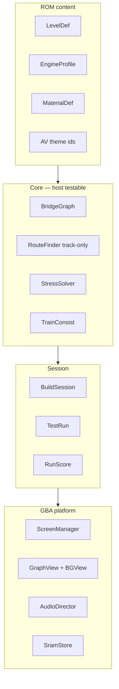

# Thomas's Bridge — Master Plan (Engine v2 → Ship)

**Status:** Approved direction · **Target:** Game Boy Advance product ship  
**Audience:** Future implementation sessions — read this before writing code.

This document consolidates architecture decisions, design insights, and the phased path from the current mechanics prototype to a **finished handheld experience**: rich play loops, authored graphics, high-quality audio, lore integration, replay meta, and host-tested simulation — without repeated refactors.

Related: [Architecture](architecture.md) · [Future expansion](future-expansion.md) · [Game design](game-design.md) · [Lore leak](lore-leak.md) · [Graphics](graphics.md) · [Audio](audio.md) · [Testing](testing.md) · [Hardware](hardware.md)

---

## 1. Vision (what “done” means)

| Today | Ship target |
|-------|-------------|
| One implicit strut type; train follows any link | **Track vs brace vs foundation** — explicit route vs structure |
| Procedural placeholder pixels | **Authored Aseprite art** + BG parallax themes |
| Generated MOD/WAV placeholders | **Polished score** per mode + sync’d SFX (chuff, snap, stings) |
| 3 levels, unlock bits | **8 data-driven tracks**, stars, par cost, SRAM replay records |
| ~1900-line `main.cpp` | **Thin main** + screens + view + testable session layer |
| Meme HUD only | **Surface charm + optional PG lore** ([lore-leak.md](lore-leak.md)) woven into rare strings and level flavor |

### Product pillars (every decision serves one)

| Pillar | Player feels | Engineering means |
|--------|--------------|-------------------|
| **Clarity** | “I know where the train goes.” | Track-only pathfinding; distinct sprites per link role |
| **Craft** | “My bridge is mine.” | Build tools, undo, weak preview, ★ efficiency scoring |
| **Character** | “Sodor has a pulse.” | Mode music, chuff-sync, Hatt reactions, themed BGs |

---

## 2. Knowledge insights (do not re-litigate)

### 2.1 Simulation

- **All struts are equal today.** `_bfs_path()` walks every link — diagonal braces become accidental train routes. This breaks hill/viaduct design.
- **Angled travel already works** (`lerp` along links). The missing piece is **topology intent**, not physics.
- **Reinforcement today is geometric** (joint count + triangulation in `physics::effective_max_tension`), not a material shop. Keep geometry; add explicit roles.
- **Engines = load** (weight, speed, coaches). **Materials = capacity** (strength, cost). **Link roles = route vs structure.** Never tie materials to engine type.
- **Host tests are the source of truth** for simulation. GBA `main.cpp` must not be the test harness.

### 2.2 Presentation (bugs found)

- Parallax must use **stored base positions + scroll offset**, not recomputed row formulas ( broke 4×2 sky grid).
- **Sky/hills/water belong in BG layers** long-term; OAM is for train, links, nodes, HUD, juice.
- Per-level `deck_y` and bank ground alignment matter for hill levels (elevated deck + underground anchors at `TRACK_Y`).

### 2.3 Play loops

- Mode graph: Attract → Level select → Engine select → Build → Test → Result → (advance / retry / menu).
- After level win: advancing to next track **without forced engine re-select** reduces friction (implemented on backdrop fix branch).
- `no_path` on test start should **return to build** with brief NO GO — not trap player in test mode.
- Every shipped level needs a **documented reference solution** in `include/level_solutions.h` + host playthrough test (Knapford pattern).

### 2.4 Content & lore

- [Lore leak](lore-leak.md) is **optional PG** — safe surface for kids; rare HUD rolls (~4%) for friends. Wire via `intro_dialog_id` and level `flags`, not blocking gameplay.
- Level flavor: Knapford (normal), Gordon's Hill (wrong sky whisper), Vicarstown (industrial unease) — data flags + strings, not separate code paths.

### 2.5 Graphics & audio upgrade

- Current `gen_graphics.py` output is **layout proof**, not final art. Pipeline: Aseprite → indexed BMP → `validate_graphics.py` → Butano rebuild.
- Audio is **original parody** — never ship licensed Thomas theme. Expand: engine idle motifs, level leitmotifs in Yard MOD, tighter chuff lock to sprite frames.

---

## 3. GBA hardware budget (design inside silicon)

### 3.1 Frame budget (60 Hz)

| Subsystem | Target | Rule |
|-----------|--------|------|
| Simulation | ≤ 15% | Fixed-point; no heap; ≤ 16 nodes / 32 links |
| Sprite sync | ≤ 25% | Diff updates; pools |
| BG scroll | ≤ 5% | Affine parallax |
| Headroom | ≥ 40% | Shake, dust, rare banners |

### 3.2 Video memory target

```
BG3  Sky + far hills     scroll ~0.125×
BG2  Mid cliffs / theme  scroll ~0.25×
BG1  Banks + water anim  scroll ~0.5×, 8-frame ripple
OAM  Train, links, nodes, HUD, FX
```

Keep `BN_CFG_SPRITE_AFFINE_MATS_MAX_ITEMS=32` for rotated links.

### 3.3 SRAM (≤ 64 B of 256 B)

```
[ magic | version | checksum ]
[ unlocks: levels | engines | tutorials ]
[ per-level: best_stars | best_cost | flags ]
[ optional: ghost link list — compressed ]
```

Version all fields; migrate in `save_data::decode`.

---

## 4. Software architecture (build once)



### 4.1 Core types (keystone)

**LinkRole** — where can the train go?

| Role | Train path | Player intent |
|------|------------|---------------|
| `track` | Yes | Deck / rail (straight or angled) |
| `brace` | No | Diagonal rod, truss tie |
| `foundation` | No | Underground pier (v2) |

**MaterialId** — how strong?

| Material | Use |
|----------|-----|
| `timber` | Default track beams |
| `rod` | Braces; higher strength, shorter safe span, higher cost |

**Link** (replaces `Strut`):

```cpp
struct Link {
    NodeId a, b;
    LinkRole role;
    MaterialId material;
    bn::fixed length, max_tension, current_tension;
    bool triangulated;
};
```

**RouteFinder:** BFS/A* on `track` links only, START_NODE → END_NODE.  
**StressSolver:** Train load on **route track links**; braces count for joint/triangle bonuses.  
**TrainConsist:** Engine + coaches (`coach_count`) — load ramps along link.

### 4.2 LevelDef (data-driven)

```cpp
struct LevelDef {
    const NodeSeed* nodes;
    int node_count;
    LinkRoleMask allowed_roles;
    MaterialMask allowed_materials;
    bn::fixed deck_y, build_y_min, build_y_max;
    bn::fixed safe_length;
    int par_cost, par_links;
    uint8_t bg_theme_id;
    engine::Id recommended_engine;
    BuildToolMask tools_at_start;
    uint8_t intro_dialog_id;  // lore / tutorial
};
```

**Tool unlock by level:**

| Level | Tools | Skill taught |
|-------|-------|--------------|
| Knapford | place + track | Span splitting |
| Gordon's Hill | + brace | Deck vs support, hill |
| Vicarstown | + rod material | Efficiency under budget |

### 4.3 Build tools

```cpp
enum class BuildTool { place, track, brace, erase, undo };
```

- **Select** cycles tool; **L** cycles material on current tool.
- Preview uses **selected engine weight** for weak warning.

### 4.4 Session & scoring

```cpp
struct RunScore {
    int nodes_used, track_links, brace_links, material_cost;
    uint8_t stars;  // 3 if cost ≤ par, 2 if ≤ par×1.25, 1 if clear
};
```

`LevelSession` — used by GBA and host tests:

```cpp
bool apply(BuildCommand);
TestResult begin_test();
TestResult tick();
RunScore score() const;
```

---

## 5. Mode graph & AV contract

| Mode | Music | SFX highlights | Visual |
|------|-------|----------------|--------|
| Attract | Island Line | — | Splash, hints, blink START |
| Level select | Yard | UI tick | Track thumbnail, Hatt stern |
| Engine select | Yard | UI tick | Portrait, weight, chuff idle |
| Build | Workshop | UI | Graph, weak preview, tool HUD |
| Test | Full Steam | Peep, chuff | Train, hot links, BG scroll |
| Win | → Useful + Whistle | — | Hatt OK, ★, unlock flash |
| Fail | Snap + Delay + Splash | — | Shake, dust, Hatt furious |
| Pause | Duck music 20% | UI | Menu row |

**AudioDirector** owns cues, fades, ducking — screens request, never call `bn::music` directly.

---

## 6. Source layout (target)

```text
src/
  main.cpp                 # init + ScreenManager.update() only
  core/                    # graph, path, stress, train
  session/                 # BuildSession, TestRun, RunScore
  content/                 # level, engine, material tables
  platform/gba/
    screens/               # attract, select, build, test, result, pause
    view/graph_view.cpp
    view/bg_view.cpp
    audio/director.cpp
    save/sram_store.cpp
include/
  level_solutions.h        # reference bridges — CI gate
tests/
  test_physics.cpp         # + run_level_playthrough per level
  test_session.cpp         # (new) build commands, scoring
tools/
  validate_graphics.py
  validate_level.py        # (new) reference path exists, par achievable
graphics/
  bg_knapford/ …           # per-theme BG tilesets
  train_thomas.bmp …       # authored 32×32 sheets
audio/                     # polished MOD + WAV
```

---

## 7. Graphics direction (escape placeholder look)

### 7.1 Visual language

| Element | Spec |
|---------|------|
| Track link | 16×8 timber, rail highlight, rotate + scale |
| Brace | 16×4 rod, darker palette |
| Foundation | 8×16 pier into ground |
| Node / anchor | 16×16 rivet / bank bolt |
| Train | **32×32 native**, 4–6 frames per engine |
| Hatt | Bust + stern / furious / peep |
| Stress | Palette row green → amber → red on same sprite |

### 7.2 BG themes

| Theme | Levels | Notes |
|-------|--------|-------|
| `knapford` | Creek | Pale sky, flat meadows, ripple water |
| `hill` | Gordon's Hill | Raised embankment, valley water low |
| `viaduct` | Vicarstown | Industrial sky, canal/lock hints |

### 7.3 Juice (cheap, high impact)

- Camera shake 4px × 8 frames on snap
- 4–6 dust sprites on fall
- Crack frame before link erase
- Hatt bounce on win
- Rare lore banners (~4% existing roll)

### 7.4 Art pipeline

1. Author in **Aseprite** at native sizes, ≤ 16 colors, index 0 transparent.
2. Drop BMPs into `graphics/`, keep JSON basenames for Butano items.
3. `python3 tools/validate_graphics.py` in CI.
4. `gen_graphics.py` → validator-only long-term (stop overwriting authored art).

---

## 8. Audio direction (high quality within GBA)

| Cue | Purpose | Quality bar |
|-----|---------|-------------|
| Island Line | Title, epilogue | Memorable 32-bar march, clear lead |
| Yard | Menus | Light idler + per-unlock motif |
| Workshop | Build | Loopable, non-fatiguing 60s |
| Full Steam | Test | Tension rise, tempo sync crossing |
| SFX | Peep, chuff, snap, stings | Short, punchy, chuff **frame-locked** to train |

- Pause: duck to 20%, restore on resume.
- Win: stop bed → Useful → Whistle (30ms gap).
- Fail: snap → delay → splash stack.

Regenerate: `python3 tools/gen_audio.py`; CI: `gen_audio.py --check`.

---

## 9. Lore integration (without blocking ship)

| Surface | Implementation |
|---------|----------------|
| Rare win/fail strings | Existing `_lore_rare()` rolls — expand tables |
| Level intro | `intro_dialog_id` → 1–2 line panel on first visit |
| Level select flavor | Subtitle under track name from level def |
| Epilogue | All-clear screen + [lore-leak](lore-leak.md) sting for friends |
| **Never** | Mandatory horror, kid-blocking walls of text |

Flags in SRAM: `tutorial_seen`, `lore_whisper_seen` per level.

---

## 10. Testing pyramid (ship confidence)

```
        EverDrive / hardware     timing, SRAM, feel
        mGBA + web playtest      full loops, command queue
        Host tests               physics, session, every level playthrough
        validate_graphics/audio  asset lint
```

**CI must pass before ROM deploy:**

- `make -C tests` — includes `run_level_playthrough(n)` for **all** shipped levels
- `cd web && npm test`
- `validate_graphics.py` + `gen_audio.py --check`

**New tests to add during v2:**

- `test_session.cpp` — BuildCommand, undo, tool rules, star calculation
- `validate_level.py` — reference solution reaches success, par ≥ 3★ cost

Manual checklist: [testing.md](testing.md) M1–M5.

---

## 11. Implementation phases (ordered — do not skip)

### Phase 0 — Baseline (done / in PR #13)

- [x] Fix backdrop parallax base positions
- [x] Per-level `deck_y`, Knapford deduped seeds
- [x] Knapford reference solution + host playthrough test
- [x] Level advance without engine re-select; no_path auto-return

### Phase 1 — Simulation keystone (vertical slice blocker)

- [x] `LinkRole` + rename `Strut` → `Link`
- [x] `RouteFinder` — track-only BFS
- [x] `BuildTool` track vs brace in `BuildSession`
- [x] Two sprites: deck beam vs rod brace
- [x] Gordon's Hill golden slice: build brace + track, host test, web E2E

### Phase 2 — Code structure

- [x] Extract `core/`, `session/` from `bridge_system` + `main.cpp`
- [x] `ScreenManager` + `screens/*` (≤ 400 lines each)
- [x] `GraphView` diff sync from session events
- [x] `AudioDirector` — single cue owner

### Phase 3 — Content & scoring

- [x] `LevelDef` v2 fields (tools, par, theme id)
- [x] `MaterialId` rod + cost in `RunScore`
- [x] Save v2 — stars + best cost per level
- [x] Results screen ★ reveal
- [x] Reference solutions + playthrough tests for all shipped levels

### Phase 4 — Graphics upgrade

- [x] BG parallax themes (move sky/water off OAM)
- [x] Authored train 32×32, struts, nodes, Hatt (committed BMPs; Aseprite drop-in ready)
- [x] Per-level BG tilesets
- [x] Stress palette swap, snap crack frame
- [x] `validate_graphics.py` on authored assets

### Phase 5 — Audio polish

- [x] Rework MOD loops (less “generated”, more composed)
- [x] Chuff lock to train frame + speed
- [x] Engine select idle motif per engine
- [x] Level unlock leitmotif in Yard

### Phase 6 — Lore & flavor

- [x] `intro_dialog_id` panels per level (first visit)
- [x] Expand rare string tables from [lore-leak](lore-leak.md)
- [x] Level select subtitles / whispers
- [x] Epilogue lore beat on all-clear

### Phase 7 — Ship

- [ ] Full manual QA M1–M5 on hardware (H1–H6 — pending physical device)
- [x] Web playtest walkthrough artifact
- [x] Release ROM + Docker + changelog
- [ ] Optional: ghost replay, challenge flags (post-ship)

---

## 12. Anti-patterns (hard stops)

| Don't | Do |
|-------|-----|
| Float physics | `bn::fixed` only |
| All scenery as sprites | BG + OAM split |
| Grow `main.cpp` | Screens + session + view |
| Materials tied to engines | Separate axes |
| New levels without reference tests | `level_solutions.h` + CI |
| Features before golden slice | Gordon's Hill track+brace first |
| Overwrite authored BMPs with gen_graphics | Validator-only generator |

---

## 13. Expansion hooks (post-ship, no refactor)

- Coach consist delayed loads on route
- Wind / lateral force in `StressSolver`
- Engine quirks (Diesel stat lie) via `EngineProfile` flags
- Challenge modes (Percy-only, rod budget) via `LevelDef` bitfield
- Ghost replay from compressed winning link list in SRAM
- Lift bridge / signal nodes via scripted `NodeFlags`

Reserve `engine::Id` and `bg_theme_id` values now; implement as content.

---

## 14. Next session goal

**See [session-goal.md](session-goal.md)** — copy the goal block into a new Cloud Agent or local session to execute Phase 1 → Phase 7 through ship.

---

## 15. Decision log

| Date | Decision |
|------|----------|
| 2026-08-28 | Adopt Engine v2: LinkRole + session layer + BG/OAM split + authored AV |
| 2026-08-28 | Track vs brace out of the box before costing/stars UI |
| 2026-08-28 | Host playthrough test required per shipped level |
| 2026-08-28 | Lore stays optional/rare; level intro flags for first-visit whispers |
| 2026-08-28 | Vertical slice = Gordon's Hill with track + brace before scaling content |
